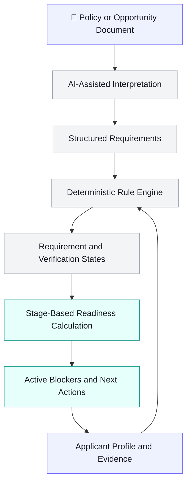

<div align="center">


# FORMLESS

### From complex requirements to application readiness.

**An AI-assisted, evidence-aware platform that transforms lengthy policy documents into structured requirements, verifiable evidence, and actionable next steps.**

*Understand the rules. Organize the evidence. Know what to do next.*

[](https://www.python.org/)
[](https://fastapi.tiangolo.com/)
[](https://www.sqlite.org/)
[](https://ai.google.dev/)
[](https://vite.dev/)

[Overview](#-overview) • [Features](#-key-features) • [Architecture](#-how-it-works) • [Getting Started](#-getting-started) • [Testing](#-testing)

</div>

---

## 📌 Overview

Applying for internships, scholarships, and institutional programs often means navigating lengthy PDFs, complicated eligibility criteria, supporting documents, and joining instructions.

The challenge isn't always finding an opportunity. It's understanding **what applies to you, what evidence you need, and what could prevent you from moving forward.**

**FORMLESS is designed to make that process clearer.**

It transforms policy-driven application workflows into structured requirements, connects those requirements to applicant information and evidence, and identifies unresolved blockers based on the stage of the application.

Instead of treating an application as a simple checklist, FORMLESS models readiness as a continuous, evidence-aware process.

> **Requirement → Evidence → Verification → Action → Readiness**

## 🎯 The Problem

Traditional application processes put the burden of interpretation and tracking on applicants.

- 📄 Important conditions are buried inside lengthy documents.
- 🔍 Eligibility criteria can be difficult to interpret and organize.
- 📎 Supporting evidence is scattered across files and records.
- ⚠️ Missing or unverified information can go unnoticed.
- 🧩 Some requirements depend on other documents or prerequisites.
- 🧭 Applicants often lack a clear picture of what to do next.

A basic checklist can tell you what is missing. It cannot always explain what matters, what needs verification, or what is blocking your progress.

## 💡 The FORMLESS Approach

FORMLESS aims to turn document-heavy application processes into a structured workflow that helps applicants understand their requirements and make progress with greater clarity.

| Question | How FORMLESS helps |
|---|---|
| What do I need? | Structures requirements from policy and opportunity documents. |
| What evidence supports it? | Connects requirements to applicant information and supporting evidence. |
| What is actually verified? | Distinguishes verified items from missing or unverified information. |
| What should I do next? | Identifies blockers relevant to the current application stage. |

## 🚀 Key Features

### 📄 1. Policy-to-Requirements Workflow

Transform lengthy policy documents and opportunity notices into structured requirements that are easier to understand, review, and act upon.

### 🔗 2. Evidence-Aware Tracking

Connect requirements to applicant information and supporting evidence, creating a more traceable process than a conventional checklist.

### ⚙️ 3. Deterministic Rule Engine

Evaluate supported conditions through explicit rules rather than relying entirely on opaque AI-generated judgments.

Supported operators include:

- `EQUALS` and `NOT_EQUALS`
- `IN` and `NOT_IN`
- `GTE`, `LTE`, `GT`, and `LT`
- `CONTAINS`

Rules can be grouped using `ALL` and `ANY` conditions.

### ✅ 4. Verification-Aware Statuses

Not every extracted fact should automatically be considered correct or confirmed.

FORMLESS distinguishes between verified information, missing requirements, and items that still need verification.

### 🧭 5. Stage-Based Readiness

Readiness depends on the stage an applicant is trying to reach.

A requirement that blocks application submission may differ from one that blocks completion or joining. FORMLESS models these distinctions through stage-based readiness gates.

### 🧩 6. Requirement Dependencies

Some requirements depend on other documents or prerequisite evidence. Modeling these relationships helps explain why completing one requirement may not be sufficient to make an application ready.

### 📊 7. Explainable Progress

By combining requirement states, verification information, dependencies, and lifecycle stages, FORMLESS aims to make unresolved blockers easier to identify and address.

## 🧠 How It Works



The workflow follows seven steps:

1. **Ingest** — process a policy or opportunity document.
2. **Structure** — organize relevant requirements and their context.
3. **Connect** — associate requirements with applicant information and evidence.
4. **Evaluate** — check supported conditions through deterministic rules.
5. **Verify** — preserve uncertainty and identify items that require confirmation.
6. **Calculate** — determine readiness for the active application stage.
7. **Act** — identify remaining blockers and reassess progress as the application evolves.

### A Core Design Principle

**AI for interpretation. Deterministic rules for evaluation. Human judgment where verification matters.**

AI-assisted document interpretation and rule-based evaluation serve different purposes. Keeping them separate helps make system behavior more transparent, testable, and explainable.

## 🧰 Technology Stack

<div align="center">


</div>

| Technology | Purpose |
|---|---|
| Python | Backend application logic |
| FastAPI | Backend API |
| SQLModel | Data models and database interaction |
| SQLite | Local development persistence |
| Google GenAI | AI-assisted document interpretation |
| `pypdf` | PDF text processing |
| Vite | Frontend development tooling |
| Pytest | Automated backend testing |

The exact frontend framework and dependency versions should be confirmed against the current repository configuration.

## 🧪 Demonstration Scenario

The canonical demonstration uses an **FSSAI internship** application workflow.

It illustrates how the system can represent:

- Applicant profile information
- Eligibility-related requirements
- Requirements already marked as verified
- Items that still need verification
- Missing joining documents
- Prerequisite relationships between requirements
- Readiness blockers associated with a specific application stage

The example demonstrates the distinction between having information available, having evidence verified, and being ready to proceed.

*The seeded scenario is illustrative demonstration data, not an official determination of eligibility for an FSSAI internship. Always consult the latest official notice for actual requirements.*

## 📂 Project Structure

```text
formless-final-push/
├── backend/
│   ├── app/
│   │   ├── api/
│   │   ├── services/
│   │   ├── config.py
│   │   ├── models.py
│   │   └── main.py
│   ├── tests/
│   └── requirements.txt
├── frontend/
│   └── ... frontend application and configuration ...
├── Dockerfile
├── docker-compose.yml
├── docker-compose.dev.yml
├── README-DOCKER.md
├── docker-build.bat
├── docker-build.ps1
├── .dockerignore
├── .gitignore
└── README.md
```

This is an overview of the project structure. Refer to the actual repository for the complete directory tree and current implementation.

## 💻 Getting Started

### Prerequisites

- Python 3.10+ or the version supported by the current dependencies
- Node.js LTS and npm
- Git
- Docker Desktop, if using the containerized setup
- A Google GenAI API key for features that require model access

### 1. Clone the Repository

```bash
git clone https://github.com/utk-ver-supm-2005/formless-final-push.git
cd formless-final-push
```

### 2. Set Up the Backend

```powershell
cd backend
py -m venv .venv
.\.venv\Scripts\Activate.ps1
python -m pip install --upgrade pip
pip install -r requirements.txt
```

Configure the environment variables required by the current backend configuration.

For model-backed features, provide your Google GenAI API key using the exact environment variable expected by `backend/app/config.py`.

**Never commit API keys, credentials, or a populated `.env` file.**

### 3. Start the Backend

From the `backend` directory, run:

```powershell
.\.venv\Scripts\python.exe -m uvicorn app.main:app --reload --host 127.0.0.1 --port 8000
```

With the default local configuration, the API should be available at:

- API: `http://127.0.0.1:8000`
- Interactive API documentation: `http://127.0.0.1:8000/docs`

### 4. Start the Frontend

Open a second terminal at the repository root:

```powershell
cd frontend
npm install
npm run dev
```

Open the local URL printed by Vite, commonly `http://localhost:5173`.

### 5. Verify the Application

1. Confirm that both frontend and backend processes are running.
2. Open the frontend in your browser.
3. Walk through the available application workflow.
4. Inspect the browser console and Network panel if a request fails.
5. Check backend logs and frontend API configuration when troubleshooting connectivity.

> Setup commands and URLs may evolve. Follow the current repository configuration and terminal output if they differ from these instructions.

## 🐳 Docker Setup

The repository includes Docker-related files for containerized development and execution.

- `Dockerfile` — container image configuration.
- `docker-compose.yml` — primary Compose configuration.
- `docker-compose.dev.yml` — development Compose configuration.
- `README-DOCKER.md` — additional Docker instructions.
- `docker-build.bat` and `docker-build.ps1` — Windows build scripts.

For exact build and startup commands, follow [`README-DOCKER.md`](README-DOCKER.md) and the current Compose configuration.

## 🧪 Testing

Run the backend test suite from the `backend` directory:

```powershell
.\.venv\Scripts\python.exe -m pytest
```

If the relevant test module exists in the current checkout, run focused tests as needed:

```powershell
.\.venv\Scripts\python.exe -m pytest tests/test_rules_and_readiness.py -v
```

Changes to rule evaluation, evidence handling, lifecycle transitions, and readiness calculations should be covered by appropriate tests.

Automated tests should also be complemented by browser testing of the user-facing workflow.

## 🔐 Security and Responsible Use

FORMLESS is intended to support application preparation and requirement tracking. It should not be treated as a substitute for official institutional decisions.

- **Verify extracted information:** Policy extraction can miss exceptions, context, or important details.
- **Preserve uncertainty:** An item marked `NEEDS_VERIFICATION` must not be treated as verified.
- **Protect applicant data:** Assess access control, retention, logging, and secure storage before handling real documents.
- **Keep secrets private:** Store API keys in local environment configuration.
- **Validate uploaded files:** Treat uploaded documents and extracted text as untrusted input.
- **Consult official sources:** Eligibility, deadlines, and document requirements can change.
- **Understand readiness:** A readiness result reflects the state represented in the system; it does not guarantee eligibility, selection, or acceptance.

## 🛣️ Future Development

Potential development directions include:

- Improving document extraction accuracy and source traceability
- Strengthening evidence upload and verification workflows
- Making blocker explanations and next actions more actionable
- Expanding tests for lifecycle transitions and failure scenarios
- Improving resilience for scanned, malformed, and large PDFs
- Hardening privacy, file validation, authentication, and deployment
- Refining accessibility, responsiveness, and interaction feedback

These are potential development priorities, not a claim that every feature is already implemented.

## 🤝 Contributing

Contributions, suggestions, and feedback are welcome.

1. Create a focused branch for your change.
2. Add tests for changes to rules or readiness behavior.
3. Document new configuration variables and setup requirements.
4. Run relevant automated tests.
5. Manually verify the affected browser workflow.
6. Never commit credentials, real applicant documents, or sensitive personal information.

## 🐛 Troubleshooting

| Issue | What to Check |
|---|---|
| Frontend cannot reach the API | Backend status, API base URL, CORS configuration, and browser Network errors |
| Model-backed extraction fails | API key, configured model, provider quota, network access, and backend logs |
| A requirement cannot be found | Active database, seed data, and requirement identifier sent by the frontend |
| A port is already in use | Stop the conflicting process or configure an available port |
| Tests fail after a schema change | Test fixtures, database state, expected statuses, and lifecycle assumptions |

## 📌 Project Status

FORMLESS is an evolving prototype. Confirm functionality, configuration, and setup instructions against the current branch before a release or public demonstration.

## 📄 License

No license has been specified in this README. Add a `LICENSE` file and update this section before distributing the project if you intend to grant others explicit reuse rights.

---

<div align="center">

### Make requirements understandable. Make readiness actionable.

**FORMLESS**

*Bringing clarity, evidence, and direction to complex application workflows.*

[View Repository](https://github.com/utk-ver-supm-2005/formless-final-push)

</div>
